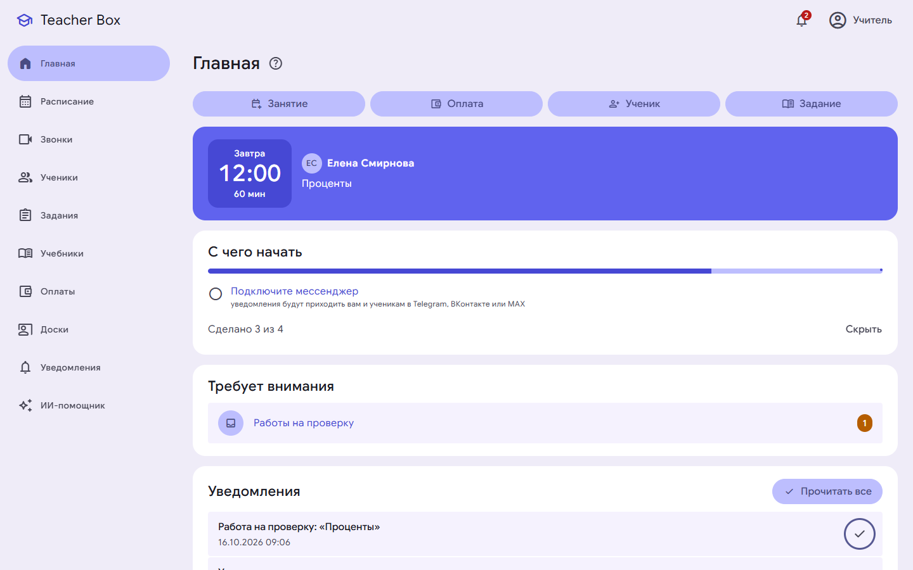
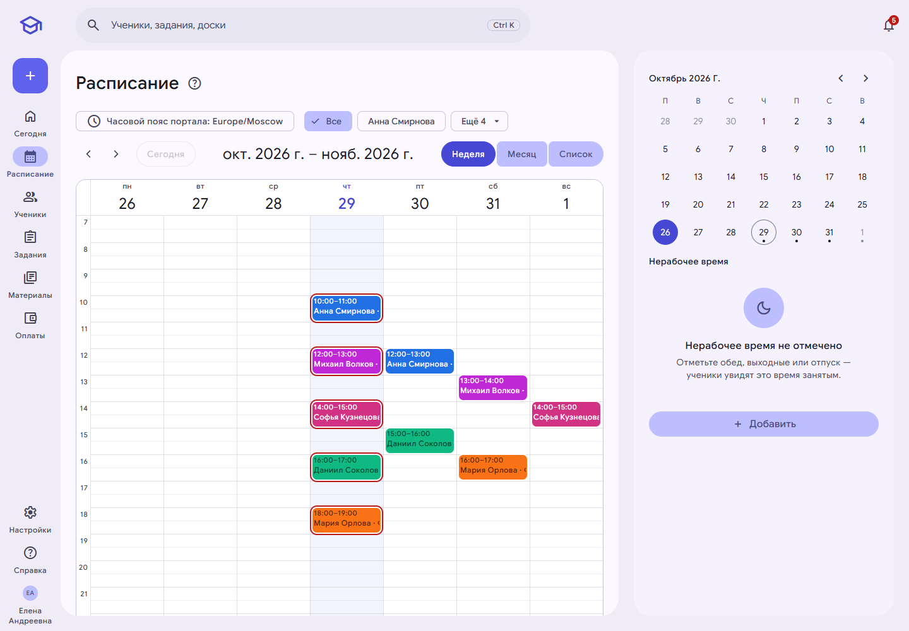
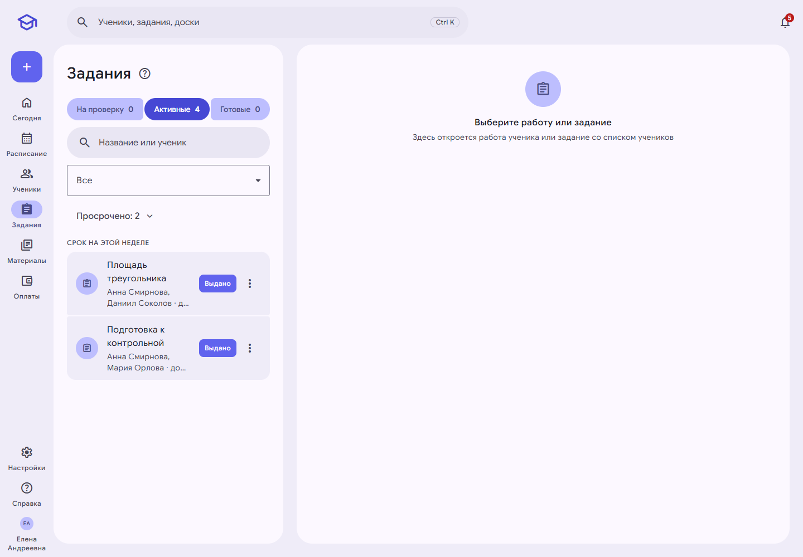
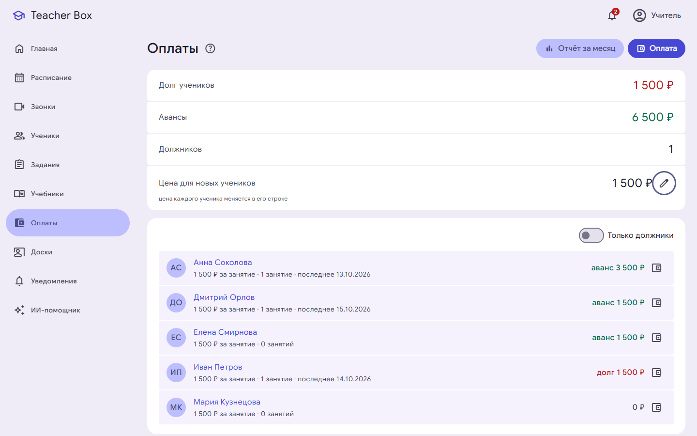
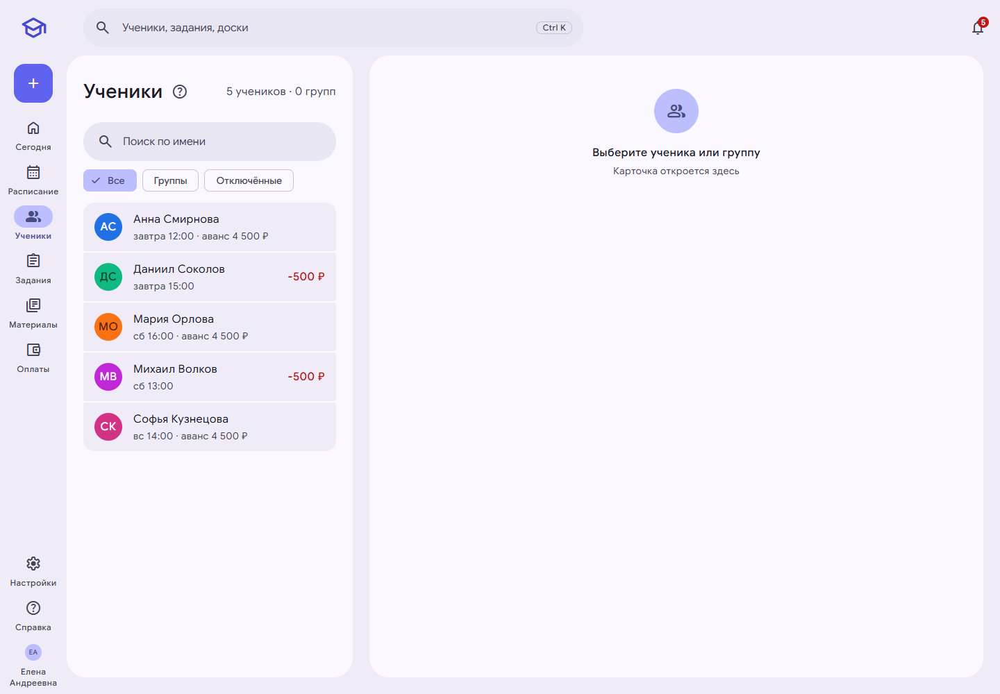
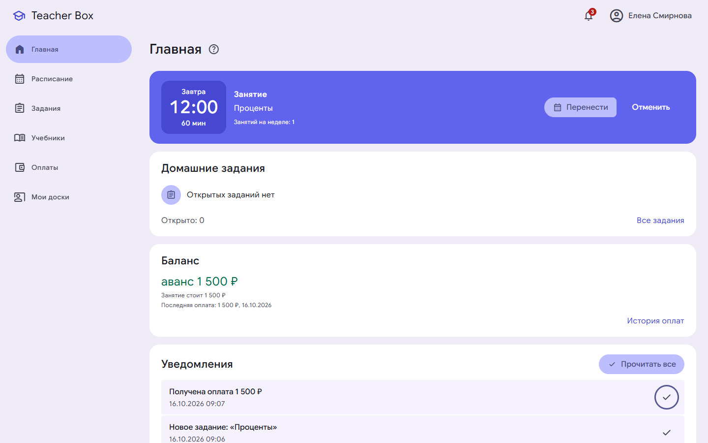
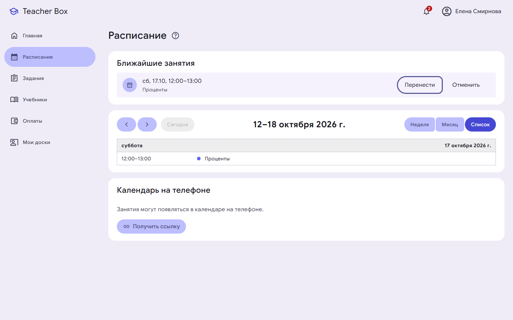
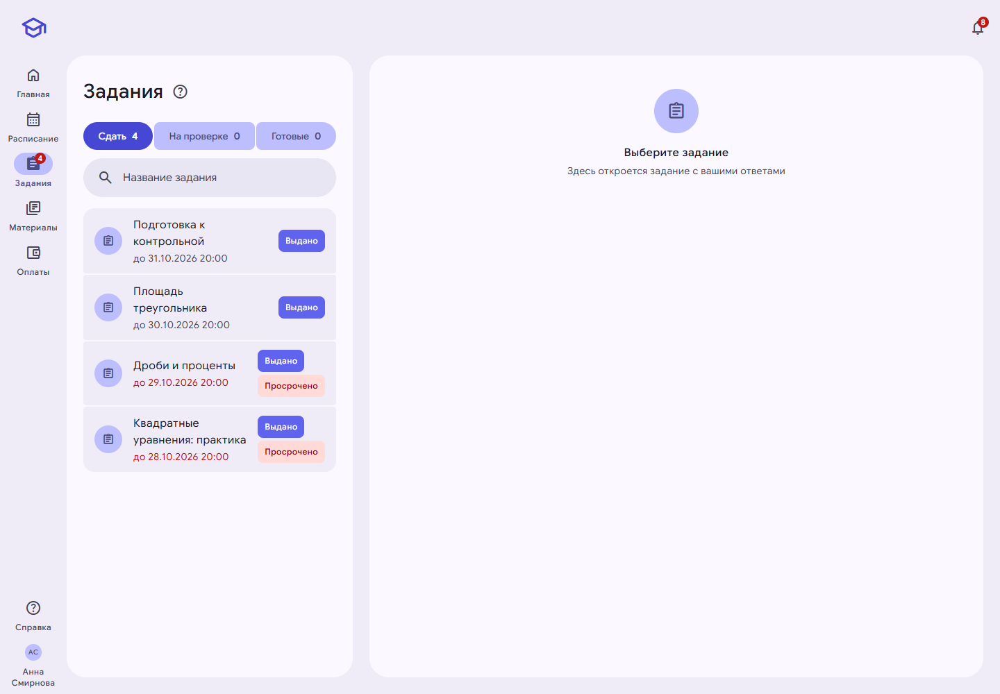
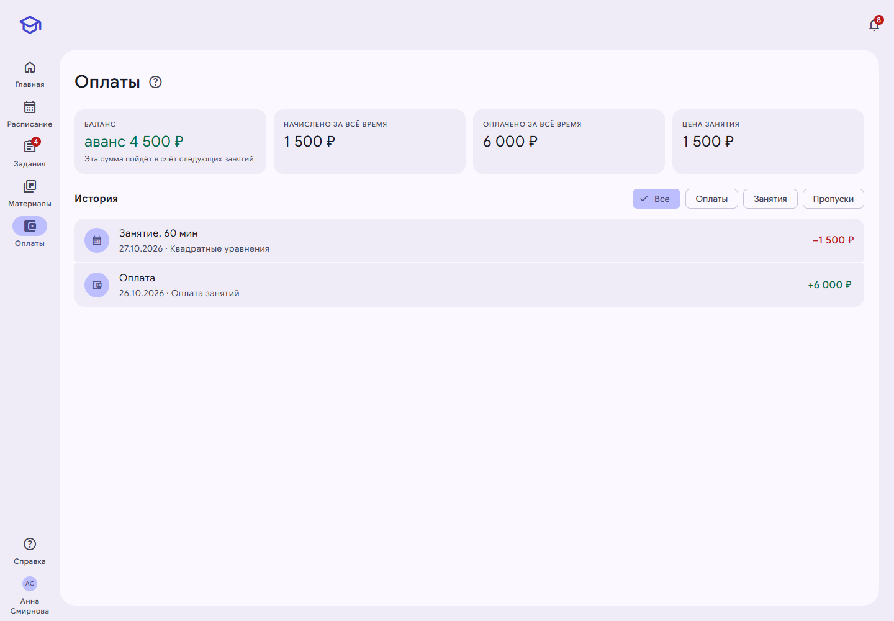

<div align="center">

# Teacher Box

#### Портал репетитора на вашем сервере: ученики, расписание, задания, оплаты, звонки и доски — на компьютере и с телефона.

[](CHANGELOG.md)
[](https://github.com/verhoturkin/teacher-box/actions/workflows/ci.yml)
[](https://github.com/verhoturkin?tab=packages&repo_name=teacher-box)
[](backend)
[](frontend)

[Возможности](#возможности) •
[Установка](#установка) •
[Скриншоты](#скриншоты) •
[Первые шаги](#первые-шаги) •
[Обновление](#обновление) •
[Частые вопросы](#частые-вопросы) •
[Документация](#документация)

</div>

[](docs/assets/readme/home.png)

Один учитель, без регистрации «с улицы»: ученики входят по ссылке-приглашению и видят только своё.
Всё хранится на вашем сервере, копии делаются каждую ночь.

## Возможности

- Ученики и группы

  - Приглашение по ссылке: ученик сам задаёт логин и пароль. У групп — своя цена занятия.

- Расписание

  - Разовые и регулярные занятия, перенос перетаскиванием, запросы учеников на перенос и отмену,
    напоминания, календарь по ссылке (ICS) и синхронизация с Google Календарём.

- Оплаты

  - Занятие списывается отметкой «Проведено» или «Пропуск». Баланс и долги каждого ученика,
    отчёт за месяц, чеки.

- Домашние задания

  - Задания в Markdown с файлами, очередь проверки, оценки и возврат на доработку, напоминания о сроке.

- Звонки

  - Встроенные видеозвонки: своя комната у каждого ученика и группы. Или внешняя ссылка —
    Телемост, Zoom и другие.

- Доски и учебники

  - Свои Excalidraw-доски: рисуете вместе с учеником, задание кладётся на доску одной кнопкой.
    Внешние доски — по ссылке. Учебники с выдачей отдельных страниц в задание и на доску.

- Уведомления

  - Telegram, ВКонтакте и MAX. Через бота можно отметить занятие, ответить на запрос переноса,
    записать оплату.

- ИИ-помощник (по желанию)

  - Черновики заданий и проверок: Claude, Gemini, DeepSeek, OpenRouter или локальная модель.
    Без него портал работает как обычно.

- Кабинет ученика

  - Ближайшее занятие с кнопкой «Войти в урок», задания со сроками, баланс, своё расписание
    и свои доски.

- Данные остаются у вас

  - Свой сервер или NAS, копии каждую ночь и по кнопке, восстановление из интерфейса.
    Отдельный вход администратора — без доступа к данным учеников.

Что умеет каждая роль — в вики: [Возможности](https://github.com/verhoturkin/teacher-box/wiki/Features).

## Установка

Нужны сервер, компьютер или NAS с **Docker** и **Docker Compose v2** (около **1 ГБ** памяти).
Портал ставится из готовых образов — сборка на сервере не нужна:

```bash
curl -fsSL https://raw.githubusercontent.com/verhoturkin/teacher-box/main/scripts/install.sh | sudo bash
```

Установщик спросит домен, часовой пояс и звонки, запишет настройки в `/opt/teacher-box/.env`
и напечатает адрес и пароль. Дальше портал обслуживает команда `teacherbox`
(`status`, `logs`, `update`, `backups`, `config`).

> [!NOTE]
> Без установщика — два файла и одна команда:
> `compose.yaml` + `.env` (из [.env.example](.env.example)), затем `docker compose up -d`.
> Для учеников снаружи нужен HTTPS: проще всего встроенный Caddy
> (`TEACHERBOX_DOMAIN` + `COMPOSE_PROFILES=https`). На NAS — тот же `compose.yaml`
> проектом Container Manager. Подробно — [вики](https://github.com/verhoturkin/teacher-box/wiki/Install).

## Скриншоты

<details>
<summary><b>Кабинет учителя</b></summary>

<table>
<tr>
<td width="50%" align="center"><a href="docs/assets/readme/schedule.png"></a><br><sub>Расписание</sub></td>
<td width="50%" align="center"><a href="docs/assets/readme/homework.png"></a><br><sub>Задания</sub></td>
</tr>
<tr>
<td width="50%" align="center"><a href="docs/assets/readme/billing.png"></a><br><sub>Оплаты</sub></td>
<td width="50%" align="center"><a href="docs/assets/readme/students.png"></a><br><sub>Ученики</sub></td>
</tr>
</table>

</details>

<details>
<summary><b>Кабинет ученика</b></summary>

<table>
<tr>
<td width="50%" align="center"><a href="docs/assets/readme/cabinet-home.png"></a><br><sub>Главная</sub></td>
<td width="50%" align="center"><a href="docs/assets/readme/cabinet-schedule.png"></a><br><sub>Расписание</sub></td>
</tr>
<tr>
<td width="50%" align="center"><a href="docs/assets/readme/cabinet-homework.png"></a><br><sub>Задания</sub></td>
<td width="50%" align="center"><a href="docs/assets/readme/cabinet-billing.png"></a><br><sub>Оплаты</sub></td>
</tr>
</table>

</details>

## Первые шаги

1. Войдите и пройдите первоначальную настройку: пароль, имя, название и адрес портала, цена занятия.
2. **«Создать»** → «Ученик» — отправьте ученику ссылку-приглашение.
3. **«Создать»** → «Занятие»: после урока отметьте «Проведено» или «Пропуск».
4. **Уведомления** → «Мессенджеры» → «Подключить» — напоминания в Telegram, ВКонтакте или MAX.
5. Проверьте копии: «Настройки» → «Резервные копии» → «Создать копию сейчас».

Пошагово — [вики](https://github.com/verhoturkin/teacher-box/wiki/First-steps).

## Обновление

```bash
sudo teacherbox update
```

При ручной установке: свежий `compose.yaml`, `docker compose pull`, `docker compose up -d`.
Перед обновлением сделайте и скачайте копию. Что изменилось — [CHANGELOG.md](CHANGELOG.md),
подробно — [вики](https://github.com/verhoturkin/teacher-box/wiki/Update).

## Частые вопросы

**Учитель забыл пароль.** Задайте в `.env` новый `TEACHERBOX_IDENTITY_TEACHER_PASSWORD` и
`TEACHERBOX_IDENTITY_TEACHER_RESET_PASSWORD=true`, перезапустите портал, войдите и верните
`..._RESET_PASSWORD=false`.

**Ученик забыл пароль.** «Ученики» → «Ссылка для сброса пароля» в строке ученика.

**Не приходят сообщения в Telegram.** Из России нужен
[прокси](https://github.com/verhoturkin/teacher-box/wiki/Proxy).

**Как перенести портал.** Скачайте копию, установите портал на новом сервере, положите архив
в `/data/restore/` и перезапустите контейнер.

Остальное — [вики](https://github.com/verhoturkin/teacher-box/wiki/FAQ).

## Безопасность

- Данные учеников не покидают ваш сервер; наружу уходят только сообщения в подключённые
  мессенджеры и — по нажатию учителя — тексты для ИИ-помощника.
- Ученик видит только своё; действия администратора пишутся в журнал.
- В интернет — только через HTTPS.

## Стек

- [Java 25](https://jdk.java.net/) + Spring Boot 4, Spring Modulith, файловый H2
- [Angular 21](https://angular.dev/) + PrimeNG 21, тема Material 3 Expressive
- Docker Compose: два контейнера (nginx и приложение), звонки — LiveKit, доски — Excalidraw

## Документация

- 📖 [Вики](https://github.com/verhoturkin/teacher-box/wiki) — руководства:
  [установка](https://github.com/verhoturkin/teacher-box/wiki/Install),
  [первые шаги](https://github.com/verhoturkin/teacher-box/wiki/First-steps),
  [мессенджеры](https://github.com/verhoturkin/teacher-box/wiki/Messengers),
  [расписание](https://github.com/verhoturkin/teacher-box/wiki/Schedule),
  [звонки](https://github.com/verhoturkin/teacher-box/wiki/Calls),
  [доски](https://github.com/verhoturkin/teacher-box/wiki/Boards),
  [ИИ-помощник](https://github.com/verhoturkin/teacher-box/wiki/AI-assistant),
  [копии](https://github.com/verhoturkin/teacher-box/wiki/Backups),
  [вопросы и ответы](https://github.com/verhoturkin/teacher-box/wiki/FAQ)
- 🛠️ [Эксплуатация](docs/operations.md) — команда `teacherbox`, копии, интеграции, диагностика
- 🧩 [Дизайн-система](docs/design-system.md) и [план](docs/PLAN.md) — для разработчиков
